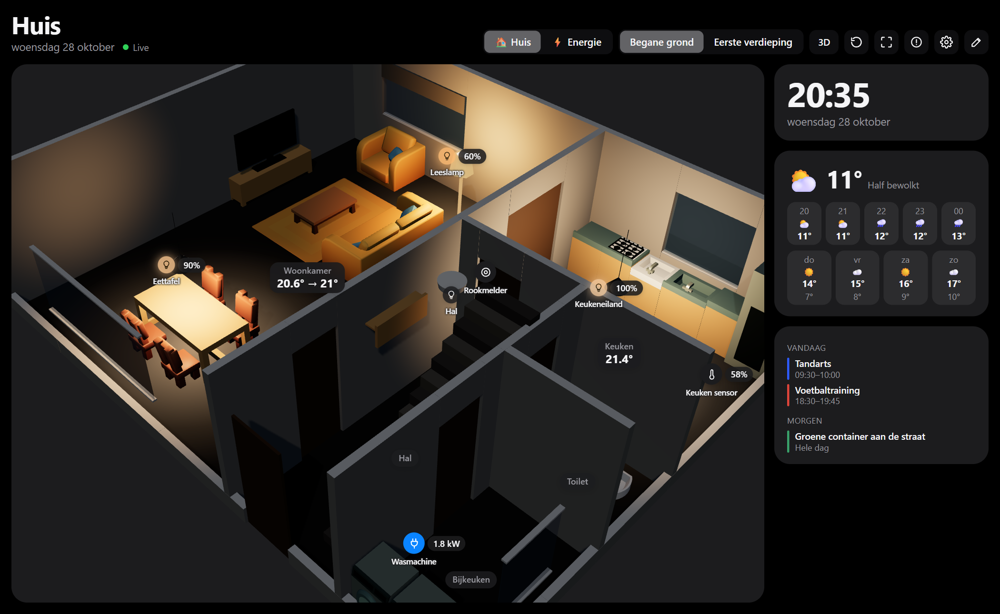

# Plattegrond Dashboard (Floor Plan Dashboard) voor Homey Pro

Je huis als live plattegrond in 2D en 3D: lampen gloeien waar ze hangen, kamers tonen hun temperatuur, zonwering en deuren hun stand, en naast elk apparaat staat de waarde die ertoe doet (°C, %, W). Tik op een apparaat voor de bediening. Met klok, weer en agenda ernaast is het een compleet dashboard voor een tablet aan de muur.

**Probeer de demo:** https://wnijhof.github.io/homey-floorplan-dashboard/ (een voorbeeldhuis, zonder Homey; de editor staat onder het potloodje).



Zusje van **Energie Dashboard**: als beide geïnstalleerd zijn, staat bovenaan elke webpagina een knop om te wisselen (⚡ Energie | 🏠 Huis).

## Gebruiken

1. Installeer de app en open in de Homey-app *Apps → Plattegrond Dashboard → Instellingen*.
2. Kies **Editor openen**: de editor is een webpagina in je thuisnetwerk (`http://<homey>:8687/editor`). Teken je huis daar op een computer of tablet; dat werkt veel prettiger dan in de Homey-app.
3. Open het **dashboard** (`http://<homey>:8687/`) op een tablet, of zet de widget **Plattegrond** op een Homey-dashboard.

Optioneel in de instellingen: een **toegangscode** (elke browser vraagt er één keer om; `?code=…` achter de link werkt ook) en een **bewerk-pincode** (gevraagd voordat de plattegrond of agenda's veranderen). Zonder toegangscode kan iedereen in je thuisnetwerk het dashboard openen en apparaten schakelen.

## Onderdelen

| Onderdeel | Waar | Wat |
|---|---|---|
| Webserver | `lib/WebServer.js`, `lib/guard.js` | Dashboard en editor op poort 8687, toegangscode (cookie), bewerk-pincode, live-updates via Server-Sent Events |
| Dashboard | `web/index.html`, `web/dashboard.js` | Schermvullend; hergebruikt de widget; wisselknop, schermkeuzes (alleen voor dat scherm), volledig scherm, scherm wakker houden |
| Editor | `web/editor.html`, `web/editor.js` | Kamers, muren, deuren, ramen, meubels, apparaten, afbeelding overtrekken, agenda's |
| Homey-stub | `web/homey-web.js` | Laat widget- en editorcode zonder wijzigingen op de webpagina draaien (fetch, EventSource, pincode-dialoog) |
| Widget | `widgets/floorplan/` | Voor Homey-dashboards; ⤢ opent het volledige dashboard |
| Instellingen | `settings/index.html` | Links, poort, toegangscode, bewerk-pincode, status, gevonden zuster-apps |
| Renderer | `lib/shared/floorplan-core.js` | Geometrie, meubelcatalogus, 2D/2.5D SVG-renderer |
| App | `app.js`, `lib/DeviceHub.js`, `lib/PlanStore.js`, `lib/Calendar.js` | Homey Web API, live capability-updates, opslag, weer, iCal-agenda |

## Wisselen met Energie Dashboard

Elke app heeft een app-API `GET /dashboard-link` (poort, draait hij, naam, icoon) en vraagt de ander op via `homey.api.getApiApp(…)` (permissie `homey:app:<andere app>`). De webpagina krijgt de lijst via `GET /api/siblings` en linkt naar hetzelfde adres met de poort van de ander. Elke poort is een eigen website: een toegangscode vul je per app één keer in.

## Ontwikkelen

```bash
npm install
npm test            # unit-tests: renderer, geometrie, iCal
npm run test:ui     # editor en dashboard tegen de echte webserver, widget met een nep-Homey (headless Edge/Chrome)
npm run dev         # webserver met voorbeeldwoning: http://localhost:8687/ en /editor (--code=…, --pin=…, --sibling-port=8686)
npm run validate    # homey app validate --level publish
npm run run         # draaien op je Homey (homey app run)
```

De browsercode blijft ES2019 (Safari 12 op oudere wandtablets): controleer met `npx acorn --ecma2019 --silent <bestand>`.

Vóór publicatie: het e-mailadres van de auteur invullen in `.homeycompose/app.json`.

## Nog niet gebouwd

- 3D-dollhouse (nu 2D en 2.5D), meerdere selectie, uitlijnhulplijnen, eigen 3D-modellen.
- Acties per object (flows/moods), heatmap over de afgelopen 24 uur.
